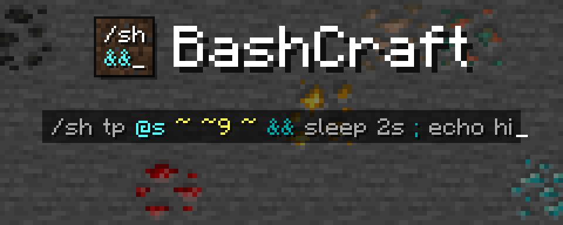

<p align="center"></p>

<p align="center"><a href="https://github.com/lsalik2/bashcraft/actions/workflows/ci.yml"></a></p>

<p align="center"><b>A bash shell for the command line: set timers, chain commands and much more.</b></p>

BashCraft is a Fabric mod that brings the best small ideas of bash to Minecraft commands. Run a command only if
another worked, pass one command's result to the next, keep values in variables, make your own commands, and set
timers — from chat, command blocks or functions, without anything new to install on players' clients.

## What it does

- **Chains** — `&&` runs the next command if the last one worked, `||` if it failed, `;` always.
- **Pipes** — `|` passes a result along: find a village, land on its surface, teleport there.
- **Variables** — remember values in one line and use them in the next, even after a restart.
- **Timers** — `sleep` pauses a chain without freezing the game; `&` lets a timer run on its own.
- **Aliases** — name a chain and use it like a command, with arguments.
- **Groups** — `( … )` bundles commands so an operator applies to all of them.

Try them in a creative world with cheats on — `tp`, `locate` and `surface` need operator permission:

**Give it a try!**

```text
/sh tp @s ~ ~5 ~ && echo up you go
/sh give @s minecraft:apple || echo no apple for you
/sh locate structure #village | surface | tp @s
/sh home="0 100 0" ; tp @s $home
/sh echo 3 ; sleep 1s ; echo 2 ; sleep 1s ; echo 1
/sh alias up = tp @s ~ ~10 ~
/sh (up && echo going up) || echo could not go up
```


## Install

- Minecraft 26.3 with Fabric Loader 0.19.5 or newer, Fabric API, and Java 25.
- Put the BashCraft jar in the server's `mods` folder (in singleplayer, in your own).
- Players don't need it: plain Minecraft clients can join and use everything. Installing the same jar on a client is
  optional and adds the [chat companion](docs/guide/08-client-companion.md), which colours chains as you type them.

## Quick start

In a creative world with cheats on:

**Give it a try!**

```text
/sh echo hello && echo world
/sh tp @s ~ ~5 ~ && echo up you go
/sh echo 3 ; sleep 1s ; echo 2 ; sleep 1s ; echo 1
```

## Learn more

The [guide](docs/guide/README.md) teaches everything step by step, with snippets to paste into chat:

0. [New to bash?](docs/guide/00-new-to-bash.md) (optional)
1. [Getting started](docs/guide/01-getting-started.md)
2. [Chains and groups](docs/guide/02-chains-and-groups.md)
3. [Variables](docs/guide/03-variables.md)
4. [Pipes and builtins](docs/guide/04-pipes-and-builtins.md)
5. [Aliases and history](docs/guide/05-aliases-and-history.md)
6. [Time: sleep, & and jobs](docs/guide/06-time.md)
7. [Chains without /sh](docs/guide/07-without-sh.md)
8. [The client companion](docs/guide/08-client-companion.md)
9. [Functions, command blocks and datapacks](docs/guide/09-functions-and-command-blocks.md)
10. [For server admins](docs/guide/10-server-admins.md)
11. [Configuration](docs/guide/11-configuration.md)
12. [Cookbook](docs/guide/12-cookbook.md)
13. [Troubleshooting](docs/guide/13-troubleshooting.md)

## Configuration

`config/bashcraft.json` sets the limits (commands per chain, nesting, timers) and turns chains without `/sh` on or
off. Every setting is described in [Configuration](docs/guide/11-configuration.md).

## Building

Needs JDK 25: `./gradlew build` puts the jar in `build/libs`. [CONTRIBUTING.md](CONTRIBUTING.md) covers the tests,
the code layout and the guide's rules.

## Contributing

Bug reports, ideas and pull requests are welcome — see [CONTRIBUTING.md](CONTRIBUTING.md). Please report security
problems privately, as [SECURITY.md](SECURITY.md) explains.

## License

MIT — see [LICENSE](LICENSE).

The BashCraft icon and the images in docs/images/ (brand art and screenshots) contain Minecraft textures and font © Mojang AB; they are not covered by the MIT license.
Not an official Minecraft product. Not approved by or associated with Mojang or Microsoft.
