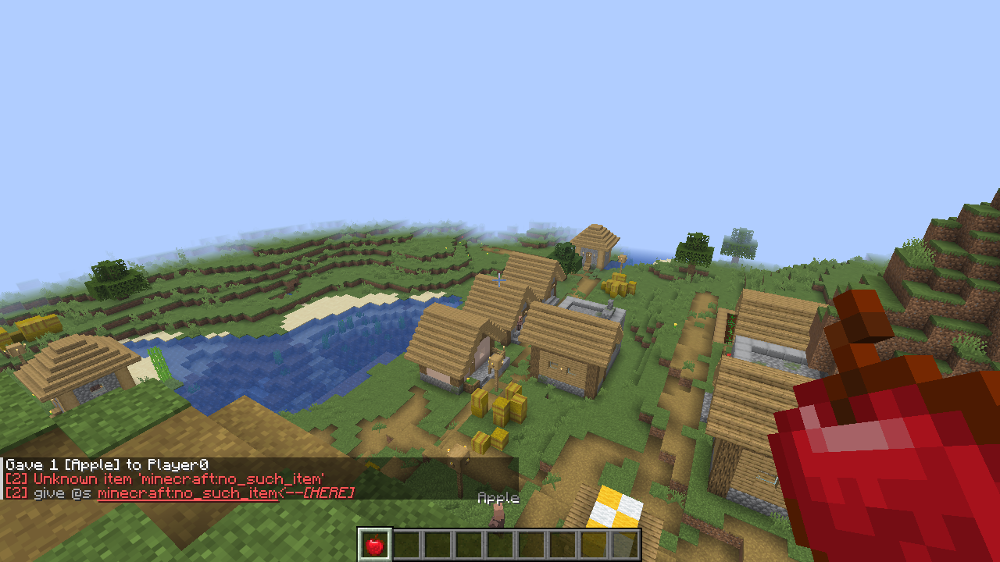

# Getting started

This page gets BashCraft running and walks you through your first chain: how to type one, what counts as success,
and how to read an error.

## Install

BashCraft is a Fabric mod for Minecraft 26.3. You need:

- Fabric Loader 0.19.5 or newer, and Fabric API;
- Java 25 (what Minecraft 26.3 runs on).

Put the BashCraft jar in the `mods` folder of your server — or of your own game for singleplayer. That's all a server
needs: players with a plain, unmodded Minecraft can join and use every feature. Installing the same jar on your
client too is optional; it adds the [chat companion](08-client-companion.md), which colours chains as you type them.

## Your first chain

`/sh` runs a *chain*: several commands on one line, joined by operators. `&&` means "and then, if that worked".

**Give it a try!**

```text
/sh tp @s ~ ~5 ~ && echo up you go
```

You're lifted five blocks, and `up you go` appears in chat — `echo` prints its text.

## What counts as success

A command succeeds when it doesn't fail with an error and reports a result above 0 — the same rule command blocks and
`/execute if` use. `echo` always succeeds, so everything after it runs.

**Give it a try!**

```text
/sh echo it worked && echo so this runs too
```

## When something fails

When a command fails, its error appears with a number in square brackets: which command in the chain it was. The
rest of an `&&` chain is skipped.

**Give it a try!**
<!-- try: errors expected -->
```text
/sh tp @s ~ ~2 ~ && give @s minecraft:no_such_item && echo never shown
```

You're lifted two blocks, then `[2]` tells you the second command — the `give` — failed, so `never shown` never
shows.



## Where chains work

Anywhere you can type a command: chat, the server console, command blocks, and function files (write `sh …` there,
without the slash). `execute … run sh …` works too. You can even skip `/sh` and type chains straight into chat — see
[Chains without /sh](07-without-sh.md) — and [Functions, command blocks and datapacks](09-functions-and-command-blocks.md)
covers the rest.

## Rules and limits

- A chain never gives anyone extra permissions: each command in it checks the permissions of whoever runs the chain,
  exactly as if it were typed on its own.
- `/sh` reports the chain's own result to command blocks and `/execute store`: the result of the last command that
  ran, and a failure (result 0) when the chain failed.
- A chain may hold up to 32 commands (`maxSegments` in the [configuration](11-configuration.md)).
- Errors carry `[n]` — the position of the failed command — whenever the chain has more than one command.
- A chain that can't be read (a stray operator, an unmatched bracket) shows what's wrong and where, and nothing in it
  runs.

---

← [Previous: New to bash?](00-new-to-bash.md) · [Guide index](README.md) · [Next: Chains and groups](02-chains-and-groups.md) →
