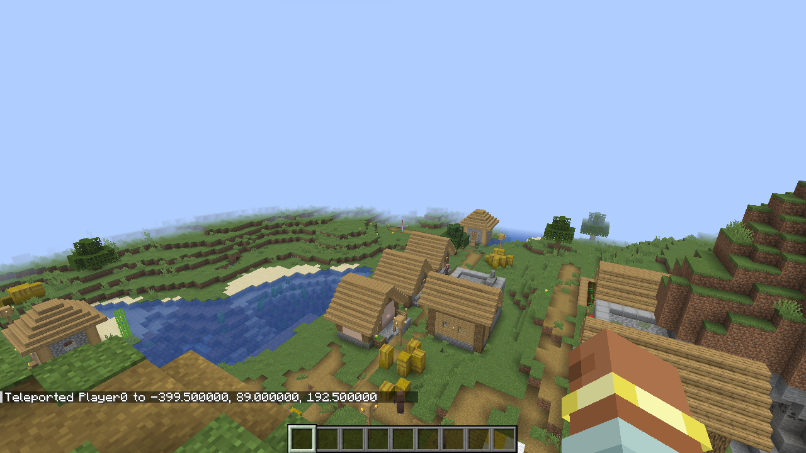

# Pipes and builtins

A pipe, `|`, hands what one command printed to the next command. This page covers what gets passed along, where it
goes, and BashCraft's own pipe commands: `grep`, `each`, `store` and `surface`.

## Pipes

BashCraft reads the first command's output and pulls out the useful part — coordinates from `/locate`, a number from
`/time query` or `/scoreboard players get`, or plain text — then adds it to the end of the next command, or puts it
wherever you write `{value}`.

**Give it a try!**

```text
/sh time query gametime | echo this world is {value} ticks old
```

## Placeholders

For coordinates you can place each part yourself: `{x}`, `{y}` and `{z}`. `{value}` is the whole value, and
`{result}` is the previous command's numeric result. `/locate` reports the height as `~`, so here we choose one:

**Give it a try!**

```text
/sh locate structure #village | tp @s {x} 200 {z}
```

You arrive high above the nearest village.

## Land on the ground with `surface`

`surface` swaps the height of piped coordinates for the ground height there, so you land on the ground instead of in
the air (or underground).

**Give it a try!**

```text
/sh locate structure #village | surface | tp @s
```



`surface` loads the chunk it looks at (generating it if needed), so like `/locate` it needs operator permission.

## Lists, `grep` and `each`

Some commands produce lists: `/list` gives the online players, `/tag … list`, `/team list` and
`/scoreboard players list` give their entries. `each` runs a command once per item, with `{value}` as the item;
`grep` keeps only the items that contain some text.

**Give it a try!**

```text
/sh list | each echo {value} is online
/sh list | each give {value} minecraft:bread 3
/sh echo apple | grep -x apple && echo found it
```

The second line gives bread to everyone online. `grep` fails if nothing is left, so `&&` works as a test.

## Keep a value with `store`

`store` saves the piped value in a scoreboard or in command storage.

**Give it a try!**

```text
/sh scoreboard objectives add demo dummy
/sh time query gametime | store score @s demo
/sh scoreboard players get @s demo
```

## Rules and limits

- What a pipe extracts: coordinates (from `/locate` and other coordinate output), numbers (`/time query`,
  `/scoreboard players get`, a numeric `/data get`), or text. Zero and negative numbers pipe like any other value; only
  an error stops a pipe.
- Commands that give real lists: `/list`, `/tag … list`, `/team list`, `/scoreboard players list`, and `/data get`
  on an NBT list. Any other command gives one item per message.
- `grep [-v] [-x] TEXT` keeps items containing TEXT, ignoring case; `-x` matches whole items only, `-v` keeps the
  others. It fails when nothing is left.
- `each COMMAND` runs COMMAND once per item and passes on the values those runs produce.
- `store score HOLDER OBJECTIVE` stores a number (rounded down); `store storage ID PATH` stores the value. Both run the
  matching vanilla command as you, so they need its permission.
- `surface` needs operator permission, never reaches beyond the world border, and isn't available in dimensions with a
  ceiling such as the Nether. `echo 100 ~ -20 | surface` works too.
- By default the output of a command that feeds a pipe is hidden, so only the end of the pipe shows
  (`swallowPipedOutput` in the [configuration](11-configuration.md)).
- `sleep` can't be used inside a pipe.

---

← [Previous: Variables](03-variables.md) · [Guide index](README.md) · [Next: Aliases and history](05-aliases-and-history.md) →
