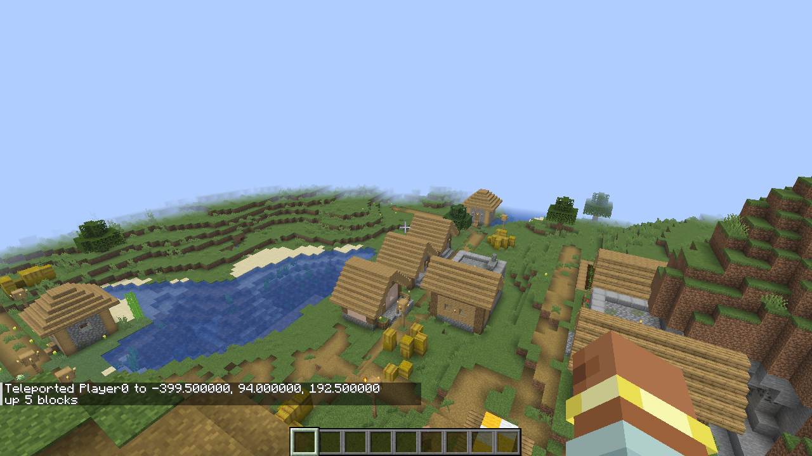

# Aliases and history

An alias is your own command: a name for a chain you use often. History lets you rerun what you typed. This page
covers both.

## Make an alias

`alias NAME = BODY` defines one; then `NAME` works like a command inside `/sh`.

**Give it a try!**

```text
/sh alias up = tp @s ~ ~10 ~
/sh up
```

## Arguments

Inside the body, `$1` … `$9` are the words you call the alias with, `$@` is all of them and `$#` how many there
are. Quote the body when it contains `&&`, `;` or `|`, so they belong to the alias.

**Give it a try!**

```text
/sh alias greet = 'echo hello $1, you are $2'
/sh greet Alex awesome
```

## Defaults

`${N:-default}` uses a default when an argument is missing.

**Give it a try!**

```text
/sh alias jump = 'tp @s ~ ~${1:-5} ~'
/sh jump
/sh jump 20
```

## The append rule

If the body uses no `$1`, `$@` or `$#` at all, whatever you type after the alias name is added to its last command.

**Give it a try!**

```text
/sh alias shout = echo HEY
/sh shout there everyone
```

You'll see `HEY there everyone`.

## List and remove

**Give it a try!**

```text
/sh alias
/sh unalias shout
```

## Global aliases

Your own aliases only run in chains you type. Operators can define *global* aliases, which work everywhere —
functions and command blocks too.

**Give it a try!**

```text
/sh alias global.lobby = tp @s 0 100 0
```

## History

BashCraft remembers the lines you type this session. `!!` reruns your last line, `!PREFIX` the last one that starts
with PREFIX, and `history` lists them.

**Give it a try!**

```text
/sh echo remember me
/sh !!
/sh !echo
/sh history
```



## Rules and limits

- Alias names: lowercase letters, digits, `_` and `-`, starting with a letter or `_`, up to 32 characters. A name
  can't be an existing command or a BashCraft word (`alias`, `echo`, `sleep`, `jobs` …): `alias name NAME is already a
  command`.
- Up to 64 aliases per set; a body up to 1024 characters and 32 commands (`maxSegments`). The body is checked when you
  define it and isn't expanded until the alias runs.
- Your own aliases run only in chains you type; global aliases run everywhere, and changing them needs operator
  permission.
- `unalias NAME` (or `unalias global.NAME`) fails with `no alias NAME` when there is none.
- Aliases calling aliases nest at most `maxDepth` (8) deep.
- History keeps your last 50 lines until you leave. `!!` and `!PREFIX` work only as a whole `/sh` line; `/sh !` alone
  is an error. `history`, `!!` and `!PREFIX` only work in chains you type.

---

← [Previous: Pipes and builtins](04-pipes-and-builtins.md) · [Guide index](README.md) · [Next: Time](06-time.md) →
