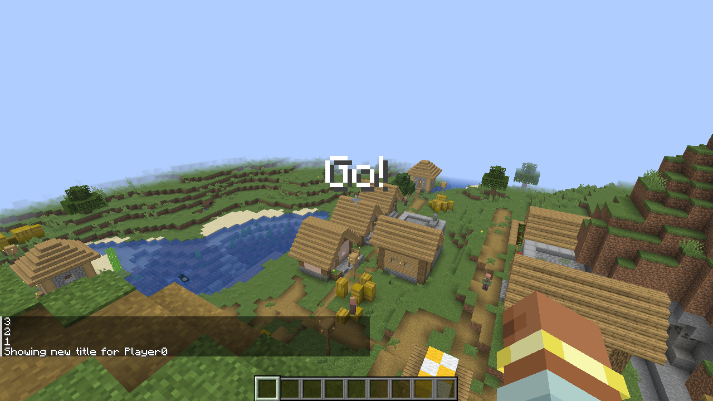
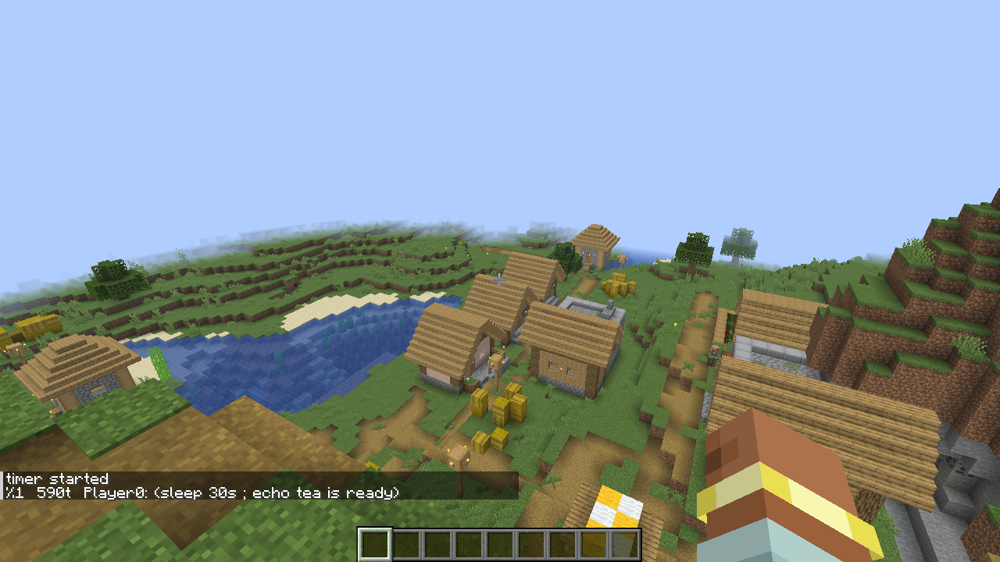

# Time: sleep, & and jobs

Chains can wait. `sleep` pauses the rest of a chain without freezing the game, `&` lets part of a chain wait on its
own while the rest carries on, and `jobs` shows what's waiting.

## Wait with `sleep`

`sleep TIME` waits, then the chain goes on. Times work like `/schedule`'s: plain numbers are ticks (20 a second),
or add a unit — `20t`, `1s`, `0.5s`, `1d` (a Minecraft day).

**Give it a try!**

```text
/sh echo 3 ; sleep 1s ; echo 2 ; sleep 1s ; echo 1 ; sleep 1s ; title @s title "Go!"
```



The server never waits: `/sh` finishes at once, and the rest of the chain runs on a later tick.

## Let part of a chain wait on its own: `&`

`X & Y` starts `X`, and if `X` sleeps, the rest of `X` waits by itself while `Y` runs straight away — a timer.

**Give it a try!**

```text
/sh (sleep 3s ; echo tea is ready) & echo timer started
```

## See and cancel waiting chains

`jobs` lists your waiting chains with a number and the ticks left; `kill %N` cancels one.

**Give it a try!**

```text
/sh sleep 5s ; echo too late
/sh jobs
/sh kill %1
```

`too late` never appears.



## Timers that repeat

An alias that calls itself after a `sleep` repeats until you stop it.

**Give it a try!**

```text
/sh alias pulse = 'effect give @s minecraft:speed 2 ; sleep 2s ; pulse'
/sh pulse
/sh jobs
/sh kill %1
```

## Rules and limits

- `sleep` takes at least 1 tick and at most `maxSleepTicks` (72000, one hour, by default).
- When a chain sleeps, `/sh` returns at once (reporting the `sleep`), and a function goes on to its next line.
- `&` takes the whole `&&`/`||` list before it, as in bash: `a && b & c` backgrounds `a && b`. In `/sh` a lone `&` is
  always an operator — write `\&` for the character (`\&&` is still a literal `&&`).
- `sleep` can't be used inside a pipe, `$( … )` or `each`, and a `sleep` that can't wait stops the chain there.
- `jobs` shows `%N  <ticks left>t  <chain>`; operators see everyone's jobs, with the owner's name. `kill %N` cancels
  job N (any `kill` without `%` is vanilla's); you can cancel your own jobs, operators anyone's.
- Limits: 8 waiting chains per player (`maxJobsPerPlayer`), 64 in total (`maxJobs`), of which command blocks,
  functions, the console and `execute as` may hold 32 (`maxServerJobs`): `too many waiting chains (max N)`.
- Your waiting chains together run at most `maxTotalCommands` (256) commands a second; a timer that runs more ends
  with an error.
- A chain you typed wakes as you are then — where you stand, with the permissions you have then — and ends if you
  leave. Other chains wake as they started, but never with more permission than the player who started them has by
  then.
- Waiting chains follow `/tick freeze` and `/tick rate` like `/schedule`, pause while an empty server is paused, and
  are not kept across restarts.

---

← [Previous: Aliases and history](05-aliases-and-history.md) · [Guide index](README.md) · [Next: Chains without /sh](07-without-sh.md) →
