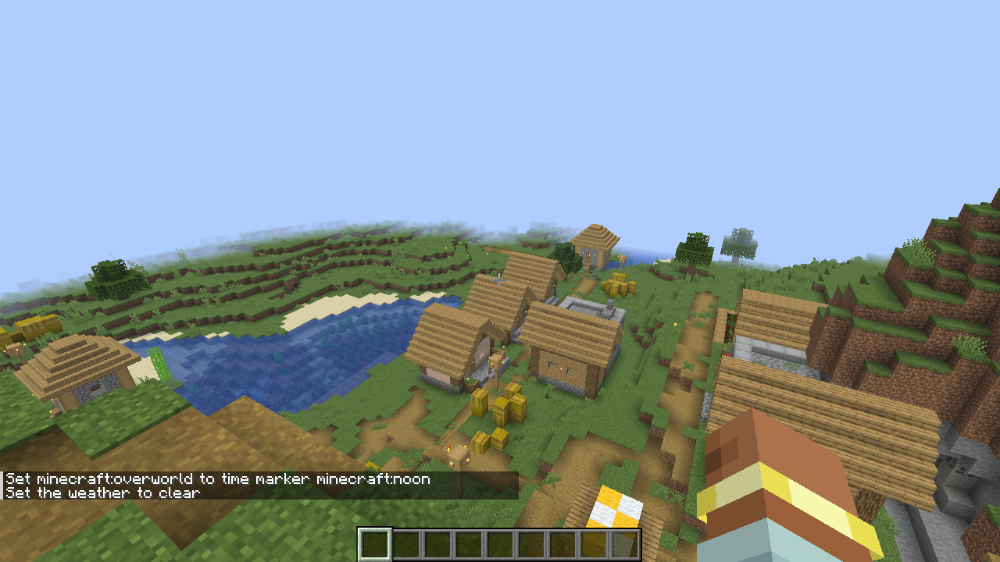

# Chains without /sh

You don't always need `/sh`. BashCraft also understands chains typed straight into chat — as long as every command
after an operator starts with `/`. This is called *transparent mode*.

## Type chains directly

Start each command with `/`, and BashCraft sees the chain.

**Give it a try!**

```text
/time set noon && /weather clear
```



## Pipes too

Pipes and placeholders work the same way.

**Give it a try!**

```text
/locate structure #village | /tp @s {x} 200 {z}
```

## Groups

A line can start with a group, and groups can follow operators — as long as a `/` command comes first inside them.

**Give it a try!**

```text
/(/echo a || /echo b) && /echo c
```

## Plain text stays plain

Without a `/` after it, `;`, `&&` or `|` is just text. That keeps ordinary messages safe:

**Give it a try!**

```text
/say lunch; then work
```

That's one ordinary `/say`: nothing after the `;` starts with `/`, so it isn't a chain.

## Rules and limits

- Transparent mode works in chat, the console, command blocks and function files (`say hi && /say there` in a
  `.mcfunction` file is a chain). Only commands that start with `/` after an operator count.
- After an operator, a group counts only when a `/` command comes first inside it (`&& (/b || /c)`), so
  `/say I love you && (hug)` is still a plain `/say`.
- A plain Minecraft client may colour such a line red as you type it; it is still sent and runs. The
  [client companion](08-client-companion.md) colours it properly.
- `&` (background) also needs a `/` after it here, like the other operators.
- Macro lines in functions (`$…`) are never treated as chains, because a macro value could otherwise add commands to
  the line.
- Set `transparentMode` to `false` in the [configuration](11-configuration.md) to turn this off; like every setting,
  it takes effect after a restart. `/sh` always works.

---

← [Previous: Time](06-time.md) · [Guide index](README.md) · [Next: The client companion](08-client-companion.md) →
