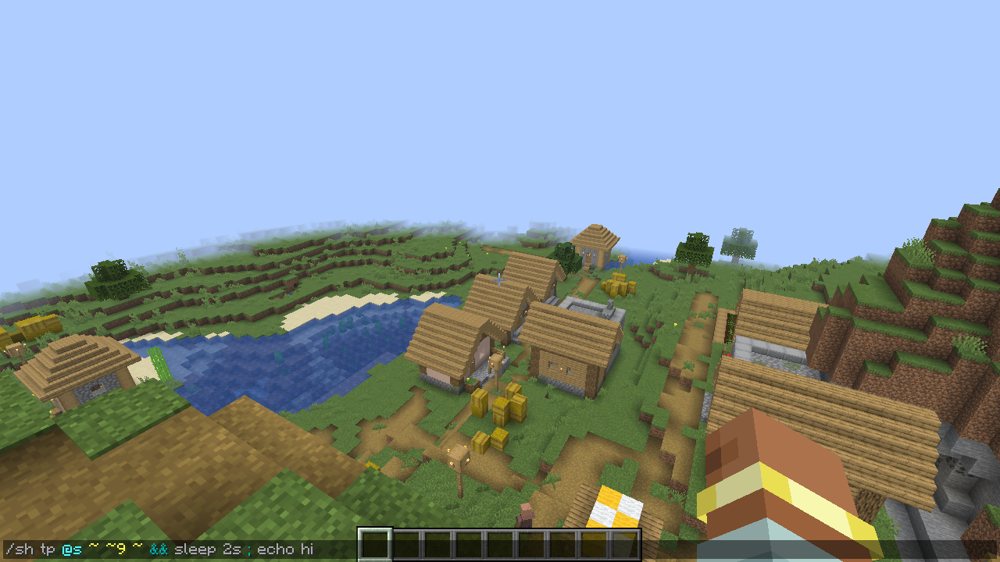

# The client companion

BashCraft runs on the server, so players with plain Minecraft can use all of it. Install the same jar on your own
client too and, on servers that run BashCraft, the chat box understands chains while you type them.

## What it adds

- **Colours.** Each command in a chain is highlighted the way Minecraft highlights a single command — no red after
  `&&` — and operators and brackets get their own colour.
- **Error hints.** BashCraft syntax errors (a stray `&&`, an unmatched bracket) show above the chat box before you
  send the line.
- **Tab completion** for the command you're typing, also inside `/sh …` lines, after operators, and in command blocks.
- **Your aliases.** Alias names are coloured like commands.



With the companion installed, type this slowly and watch the colours.

**Give it a try!**

```text
/sh tp @s ~ ~ ~ && echo look at the colours
```

## Rules and limits

- The companion is optional. Nothing changes for players without it.
- On servers without BashCraft, a client with the companion behaves exactly like plain Minecraft.
- Alias names come from the server, so the colours match what will actually run.

---

← [Previous: Chains without /sh](07-without-sh.md) · [Guide index](README.md) · [Next: Functions, command blocks and datapacks](09-functions-and-command-blocks.md) →
