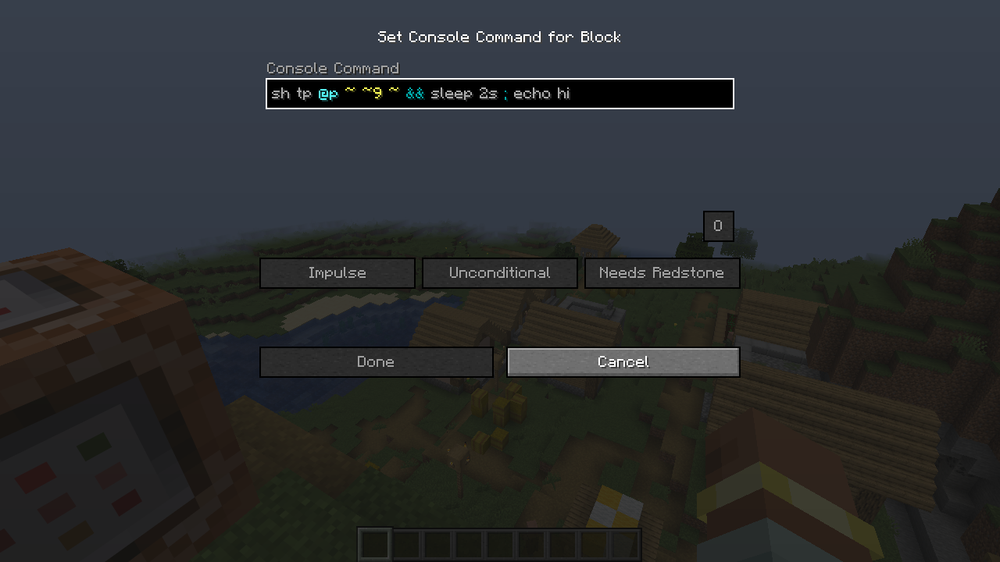

# Functions, command blocks and datapacks

Chains aren't just for chat. This page shows them in function files and command blocks, how they report results
to `/execute store`, and how datapacks can share BashCraft's variables and aliases.

## In function files

Write `sh …` lines in a `.mcfunction` file — no slash, like every other function line. A line that sleeps lets the
function carry on with its next line; the rest of that chain runs later.

```mcfunction
sh tp @a ~ ~1 ~ && effect give @a minecraft:slow_falling 5
sh title @a title "Get ready" ; sleep 3s ; title @a title "Go!"
say this runs straight after the line above starts its countdown
```

## In command blocks

Put a chain in a command block's command, starting with `sh`.

**Give it a try!**

```text
/setblock ~2 ~ ~ minecraft:command_block{Command:"sh echo hi && echo from a command block"}
/setblock ~2 ~1 ~ minecraft:redstone_block
```

The redstone block powers the command block, which runs the chain. With the
[client companion](08-client-companion.md), the command block screen colours chains as you type them:



`@s` means "the one running the command", and a command block isn't an entity — so `@s` matches nothing there. Use
`@p` (the nearest player) or another selector.

## Results and `execute store`

`sh` reports the result of the last command that ran in the chain, so command blocks, comparators and
`/execute store` work as with any command.

**Give it a try!**

```text
/scoreboard objectives add result dummy
/execute store result score @s result run sh time query gametime
/scoreboard players get @s result
```

## Datapacks, variables and aliases

- Variables live in command storage `bashcraft:vars` (`global` and `players.<uuid>`), so a datapack can read or set
  them with `/data`.
- Aliases live in `bashcraft:aliases`. Global aliases (`alias global.NAME = …`) run everywhere, including functions
  and command blocks; players' own aliases only run in chains they type.
- In functions, command blocks and the console, a plain `$x` means the global variable.

## Rules and limits

- A function without `return` counts as a success if it ran, even when a line inside it failed (as in vanilla).
- `return` inside a chain ends only that command, not the function around the `sh` line.
- Chains nested inside chains (an `sh` that runs a function with more `sh` lines, aliases calling aliases) go at
  most `maxDepth` (8) levels deep, and all of them together run at most `maxTotalCommands` (256) commands.
- Values a player controls (their own variables, pipe values, `$( … )` output) must be plain in chains run by
  functions, command blocks, the console and `execute as` — see [For server admins](10-server-admins.md).
- In macro lines you can write `$sh …` yourself, but then any `;`, `|` or `&&` inside a substituted value counts as
  an operator.

---

← [Previous: The client companion](08-client-companion.md) · [Guide index](README.md) · [Next: For server admins](10-server-admins.md) →
